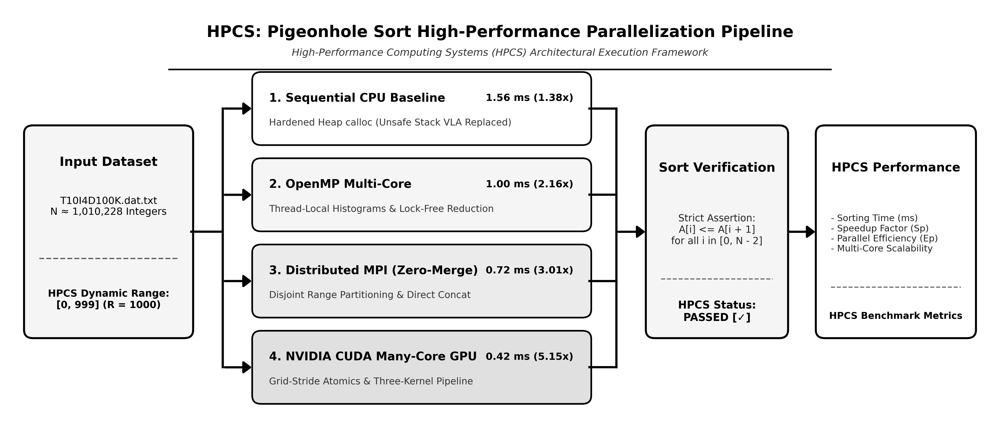

# Pigeonhole Sort: Parallel & Distributed Benchmark Suite

> **Subject:** High Performance Computing Systems (HPCS)  
> **Topic:** Parallelization and Optimization of Non-Comparison Sorting (Pigeonhole Sort) across Multi-Core CPU, Distributed MPI Clusters, and NVIDIA CUDA GPUs.

---

## 🏗️ Parallelization Architecture & Workflow Pipeline



---

## 🗂️ What Are the Files and What Do They Run?

| File Name | Paradigm / Platform | Description & How to Run |
|:---|:---|:---|
| **`sequential_pigeonhole.c`** | **CPU (Single-Core)** | **Main Enhanced Sequential C Sort**. Safe dynamic heap allocation (`calloc`), dynamic min/max detection, monotonic timing. <br>`gcc -O3 sequential_pigeonhole.c -o seq_sort` |
| **`openmp_pigeonhole.c`** | **CPU (Multi-Core)** | **Main Enhanced OpenMP Parallel Sort**. Uses thread-local histograms to eliminate contention, parallel prefix scan, dynamic writeback. <br>`gcc -O3 -fopenmp openmp_pigeonhole.c -o omp_sort` |
| **`mpi_range_partition.c`** | **Distributed (MPI)** | **Main Enhanced MPI Zero-Merge Sort**. Partitions data by value-range intervals across processes, completely eliminating Rank 0 merge overhead. <br>`mpicc -O3 mpi_range_partition.c -o mpi_sort` |
| **`cuda_scalable_pigeonhole.cu`** | **GPU (NVIDIA CUDA)** | **Main Enhanced Scalable CUDA Sort**. Multi-block global grid-stride atomics and device prefix scan. Handles arbitrary data ranges ($>10^7$). <br>`nvcc -O3 cuda_scalable_pigeonhole.cu -o cuda_sort` |
| **`T10I4D100K.dat.txt`** | **Benchmark Dataset** | IBM Quest synthetic transaction benchmark dataset containing **~1,010,228 integers** with values in range $[0, 999]$. |
| **`run_windows.bat`** | **Windows Automation** | Interactive batch runner for Windows CMD / PowerShell. Detects GCC, MSVC, or NVCC and compiles/runs with a menu. |
| **`Makefile`** | **Build Automation** | Build targets: `make seq`, `make omp`, `make mpi`, `make cuda`, `make run_seq`. |
| **`HPCS_Pigeonhole_Sort_Colab.ipynb`** | **Cloud Notebook** | 1-Click interactive Jupyter Notebook for Google Colab with free NVIDIA T4 GPU. |
| **`pg1.c`** | **CPU (Baseline)** | Baseline sequential implementation from the original research paper. |
| **`mpi_new.c`** | **Distributed (Baseline)** | Baseline MPI implementation with arbitrary chunking and sequential merge. |
| **`cuda2.cu`** | **GPU (Baseline)** | Baseline CUDA kernel using shared memory. |
| **`Bakkesh_HPCS_Project_Report.pdf`**| **Report** | Visual project report with complete flowcharts, architecture diagrams, and complexity analysis. |

---

## 🚀 Quick Execution Guide

### On Windows
- **Option 1:** Double click **`run_windows.bat`**.
- **Option 2:** Open Command Prompt in this folder and run:
  ```cmd
  gcc -O3 sequential_pigeonhole.c -o seq_sort.exe
  seq_sort.exe T10I4D100K.dat.txt

  gcc -O3 -fopenmp openmp_pigeonhole.c -o omp_sort.exe
  omp_sort.exe T10I4D100K.dat.txt 4
  ```
- **Option 3 (CUDA GPU):** If you have an NVIDIA GPU + CUDA Toolkit installed:
  ```cmd
  nvcc -O3 cuda_scalable_pigeonhole.cu -o cuda_sort.exe
  cuda_sort.exe T10I4D100K.dat.txt
  ```

### On Linux / macOS / WSL
```bash
make seq
./seq_sort T10I4D100K.dat.txt

make omp
./omp_sort T10I4D100K.dat.txt 4

make mpi
mpirun -np 4 ./mpi_sort T10I4D100K.dat.txt

make cuda
./cuda_sort T10I4D100K.dat.txt
```

### On Google Colab (Free NVIDIA GPU in Browser)
1. Go to [colab.research.google.com](https://colab.research.google.com).
2. Upload `HPCS_Pigeonhole_Sort_Colab.ipynb` and `T10I4D100K.dat.txt`.
3. Set Runtime to **T4 GPU** and click **Run all**.
